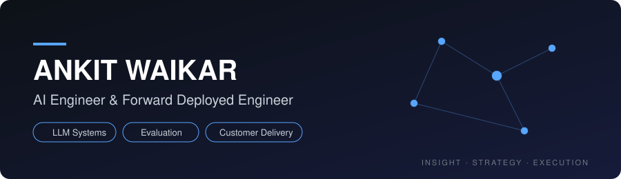

  

  
  
  
  

I build LLM systems that work in production and sit with the people who use them. I move from a messy customer problem to a shipped, measured solution: discovery, prototype, evaluation, rollout.

- AI Engineer at Amazon, working on LLM evaluation pipelines and data-quality tooling
- MS Information Systems, Syracuse University (3.9 GPA) · BE Computer Engineering
- Boston, MA · focused on agentic systems, LLM evaluation, RAG, and customer-facing AI delivery

## Selected work

**Multi-agent LLM evaluation pipeline** · Amazon 
Architected a 5-agent adversarial evaluation system on AWS Bedrock where several LLMs debate and challenge each other's judgments. It replaced most manual audit effort and surfaced a training-data error rate nearly 3x what manual spot-checks had estimated. Evaluation accuracy rose from 57% to 86% while keeping 100% recall on true errors. 
`Python` · `AWS Bedrock` · `Multi-LLM debate` · `Checkpoint/resume` · `Concurrency`

**AI quality-gate tools for data pipelines** · Amazon 
Built a Prompt Ambiguity Validator and a Verifier Assistance Tool that catch errors before they enter review, cutting upstream rework across a 128-person team. Also shipped a traceability feature (Python, TypeScript) to a platform serving 250+ daily users. 
`Prompt engineering` · `Python` · `TypeScript` · `CI/CD`

**Career-services LLM chatbot** · Syracuse University 
Designed and shipped a production chatbot end to end for 200+ students: stakeholder discovery, integration, rollout. Engagement rose 30% and support inquiries fell 40%. Authored 50+ evaluation prompts for voice and text interview simulation, lifting average scores by 0.7 points. 
`LLM` · `Prompt evaluation` · `Voice + text analysis`

**HIPAA-compliant clinical ML pipelines** · Technocolabs 
End-to-end ML pipelines for patient data, from preprocessing through deployment, improving operational efficiency by 15% under healthcare compliance constraints. 
`Python` · `scikit-learn` · `Data quality`

## Why forward deployed

I work at the point where models meet real workflows: scoping with stakeholders, building the integration, measuring it against a golden set, and iterating with the people who use it. My analytics and product background means I start from the business metric, not the model.

## Projects on GitHub

- [SU Career iBot](https://github.com/awaikar-syr/orange-bot) — multi-bot career assistant for Syracuse iSchool: RAG resume and cover-letter feedback, spoken mock interviews with tone analysis, and an alumni-analytics bot · GPT-4, Whisper, LangChain, Chroma, Streamlit
- [MBTA Red Line Timer](https://github.com/awaikar-syr/mbta-alert) — real-time dashboard that tells you when to leave to catch the next train, using the MBTA API · TypeScript
- [NBA Playoff Prediction](https://github.com/awaikar-syr/nba-playoff) — team project predicting NBA playoff teams from 40 years of Basketball Reference data; gradient boosting reached F1 0.85 and AUC-ROC 0.92 under 10-fold CV; I led the team · Jupyter
- [ankitwaikar.vercel.app](https://ankitwaikar.vercel.app) — my portfolio site
- _Coming soon: RAG assistant, LLM eval harness, MCP server_

## Open source

I'm growing my open-source practice where LLM tooling, evaluation, and developer experience meet. I care about focused fixes, clear documentation, and tooling that makes AI systems easier to test and trust.

## Toolbox

| Area | Technologies |
| --- | --- |
| AI systems | LLMs, RAG, vector databases, LangChain, MCP, prompt engineering, evaluation |
| Cloud & platform | AWS Bedrock, SageMaker, Lambda, Azure, Git/GitHub, CI/CD |
| Languages | Python, TypeScript, SQL, Java, C/C++, R |
| Data & modeling | PyTorch, NumPy, Pandas, OpenCV, PostgreSQL, MySQL, Tableau, Power BI |

## Writing

_Coming soon: notes on evaluating LLM pipelines, prompt quality gates, and shipping AI to real users._

> "Think analytically, rigorously, and systematically." — Michael O'Connell

  

**Hiring for applied AI or forward deployed roles? [Let's connect on LinkedIn →](https://www.linkedin.com/in/ankitwaikar)**
